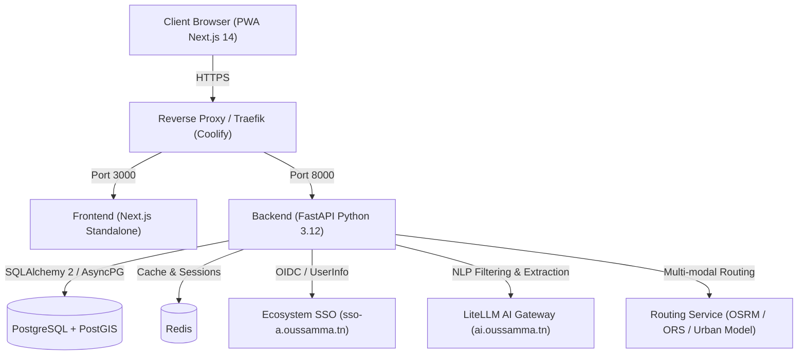

# MeetSpot Architecture & System Overview

MeetSpot is a full-stack, AI-powered multi-criteria meeting place recommendation engine built for the **oussamma.tn** ecosystem.

## High-Level Architecture

## System Components

1. **Frontend (`/frontend`)**:
   - Next.js 14 App Router, TypeScript, Tailwind CSS with official `oussamma.tn` tokens.
   - MapLibre GL JS for interactive candidate displays and routes.
   - PWA ready.

2. **Backend (`/backend`)**:
   - Python 3.12, FastAPI, SQLAlchemy 2 Async, Pydantic v2.
   - Multi-criteria deterministic equity algorithm (Minimax, Total, Balanced, Budget).
   - SSO token verification and automatic user provisioning.

3. **AI Gateway**:
   - Interfaced with `https://ai.oussamma.tn/v1` (LiteLLM) using models `chatgpt/gpt-5.4`.
   - Parses unstructured conversational user prompts into strict JSON filter schemas.
