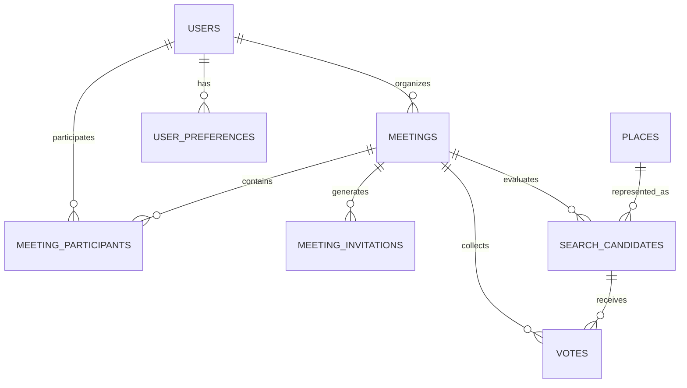

# MeetSpot Data Model

MeetSpot uses PostgreSQL with PostGIS extensions for spatial queries and location handling.

## Key Entities

- **`users`**: Platform identity tied to `sso-a.oussamma.tn`. Roles: `SUPERADMIN`, `USER`, `GUEST`.
- **`meetings`**: Collaboration project with criteria, optimization strategy, dates, and final confirmed place.
- **`meeting_participants`**: Members of a meeting with private or masked departure coordinates and individual constraints.
- **`places`**: Validated catalog of cafes, restaurants, parks, and activities with audited attributes (halal, parking, PMR).
- **`search_candidates`**: Calculated candidate spots scored by the equity algorithm with individual commute breakdowns.
- **`votes`**: Ballots submitted by participants on candidates.
